# Eclipse ♟️🌒

**Eclipse is a free, open-source UCI chess engine.** It pairs a neural-network
evaluation (**HalfKAv2 NNUE**) with a **Monte-Carlo Tree Search**, backed by an
**alpha-beta tactical verifier** — so it plays with the positional feel of a
neural engine while a classical searcher guards against tactical blunders. It
also probes **Syzygy endgame tablebases** for perfect endings.

It runs anywhere a UCI engine does: any chess GUI, the command line, or as a
Lichess bot.

> **▶ Play it right now on Lichess: [@EclipseBOT](https://lichess.org/@/EclipseBOT)**
> — challenge it to a rated or casual game.
> *(Runs 8 threads — 6 MCTS + 2 alpha-beta — on an iMac Pro, 5-piece Syzygy, ponder + PGO.)*

> **Status:** v1.2.0. Rated about 2200–2300 on Lichess (rapid ~2300, classical
> ~2250, blitz ~2170 as of November 2026). UCI, multi-threaded search, pondering,
> Syzygy tablebases and Chess960 all work. Strength is still climbing as the
> network improves; see the [releases](https://github.com/SimbaE1/eclipse-chess-engine/releases)
> for what changed in each version.

---

<!-- LICHESS:START -->
## ♟️ Live on Lichess

[](https://lichess.org/@/EclipseBOT/perf/rapid)

<a href="https://lichess.org/@/EclipseBOT">
  
</a>
<!-- LICHESS:END -->

---

## What makes it tick

| Component | What it does |
|---|---|
| **NNUE value net** | HalfKAv2 architecture (`45056 → 2048×2 → 1024 → 256 → 1`), int8/int16 quantized with an incremental accumulator and AVX-512 / AVX2 / NEON SIMD. This is Eclipse's "judgement." |
| **MCTS search** | Multi-threaded PUCT tree search explores the most promising lines — the source of its human-like, plan-oriented play. |
| **Alpha-beta search** | A classical Lazy-SMP alpha-beta search (with SEE, qsearch, LMR and a shared transposition table) runs alongside MCTS on its own threads. When it finds a better root move than the tree, Eclipse plays the alpha-beta move. Neural intuition, tactical safety net. |
| **Syzygy tablebases** | Optional; when the board is small enough, Eclipse plays endgames perfectly. |

---

## Quick start

You'll build Eclipse from source (it's small and fast to build) and download the
neural net (~190 MB) separately. Full step-by-step — including a clean Linux setup and
troubleshooting — is in **[SETUP.md](SETUP.md)**.

```bash
# 1. clone (with the Fathom tablebase submodule)
git clone --recursive https://github.com/SimbaE1/eclipse-chess-engine.git
cd eclipse-chess-engine

# 2. install build dependencies (macOS / Homebrew)
brew install cmake onnxruntime

# 3. build
cmake -S . -B build
cmake --build build -j
# -> build/src/eclipse

# 4. download the neural net into data/
gh release download v1.2.0 --pattern '*.nnue' -D data/
mv data/eclipse_v10_mix20.nnue data/eclipse.nnue
```

No `gh`? Grab the `.nnue` from the [releases page](https://github.com/SimbaE1/eclipse-chess-engine/releases/latest)
and save it as `data/eclipse.nnue`.

---

## Play against it

### In a chess GUI (recommended)

Eclipse is a standard UCI engine, so it drops into **Cute Chess**, **Arena**,
**BanksiaGUI**, **Scid vs. PC**, and friends. Add a new engine pointing at the
binary, then set its options:

- **Command:** `…/eclipse-chess-engine/build/src/eclipse`
- `EvalFile` → `…/eclipse-chess-engine/data/eclipse.nnue` *(required: always
  set it, the built-in default path only exists on the developer's machine)*
- `Threads` → total CPU threads to use (e.g. `8`)
- `Hash` → transposition memory in MB (e.g. `256`)
- `SyzygyPath` → your tablebase folder *(optional, for perfect endgames)*

### In the terminal

A small helper lets you play right in your shell (`pip install python-chess`):

```bash
python scripts/play_human.py --side w --tc 5+3 --threads 4
```

Enter moves in UCI form (`e2e4`, `g1f3`, `e7e8q` to promote). `--side w|b`
chooses your color; `--tc 5+3` is the time control.

### Raw UCI

```bash
./build/src/eclipse
```
```
uci
setoption name EvalFile value data/eclipse.nnue
setoption name Threads value 4
setoption name Hash value 256
isready
position startpos
go movetime 5000
```
It replies `bestmove …`. Type `quit` to exit.

---

## Options

The settings you'll actually touch as a player:

| Option | Default | What it does |
|---|---|---|
| `EvalFile` | — | Path to the `.nnue` net **(required)** |
| `Threads` | 4 | **Total** search threads. About one in four goes to alpha-beta (`AbThreads`), the rest to MCTS. Set to your core count. |
| `Hash` | 256 | Alpha-beta transposition table (MB) |
| `MctsTreeMB` | 8192 | Upper bound on the MCTS tree's memory (MB). Lower it on a small machine. |
| `SyzygyPath` | — | Folder of Syzygy tablebases for perfect endgames |
| `Ponder` | on | Let it think on your time (the GUI manages this) |
| `UCI_Chess960` | off | Fischer Random; most GUIs set this for you |

There are additional search-tuning knobs (`AbThreads`, `Cpuct`, `PolicyDepth`,
`AbOverrideQMargin`, …) for the curious — see [`dev/DEVELOPMENT.md`](dev/DEVELOPMENT.md).

---

## Want maximum speed?

The default build is already optimized for your CPU. For an extra ~2-10% from
profile-guided optimization:

```bash
./scripts/pgo_build.sh        # builds an instrumented binary, profiles it, rebuilds
```

This is the build that runs on [@EclipseBOT](https://lichess.org/@/EclipseBOT).

---

## For developers

This repository is set up for **using** Eclipse. If you want to hack on the
engine, retrain the network, or run strength tests, everything lives under
[`dev/`](dev/):

- [`dev/DEVELOPMENT.md`](dev/DEVELOPMENT.md) — engine internals, the build/test loop, search tunables
- [`dev/KAGGLE.md`](dev/KAGGLE.md) — the NNUE training pipeline (data → GPU → `.nnue`)
- [`dev/RELEASE_CHECKLIST.md`](dev/RELEASE_CHECKLIST.md) — how a version gets tested and shipped
- `dev/scripts/` — training, data, conversion, and match/evaluation tooling
- `dev/notebooks/` — the training notebook

## Acknowledgements

Eclipse builds on ideas and tools from DeepMind, the Stockfish & Lc0 teams,
Syzygy, and many open-source libraries. See [`ACKNOWLEDGEMENTS.md`](ACKNOWLEDGEMENTS.md).

## License

GPL-3.0-or-later. See [`LICENSE`](LICENSE).
